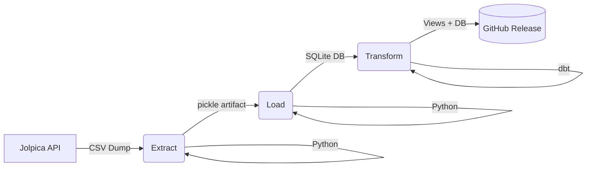
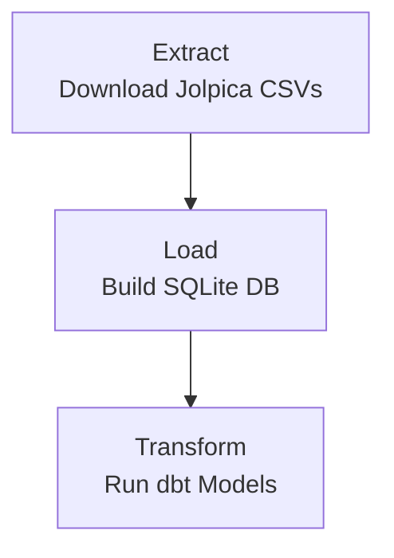

# F1 ETL Pipeline

[](https://github.com/jmr-lab/f1-etl-pipeline/actions)
[](LICENSE)
[](https://www.python.org/)
[](https://www.getdbt.com/)
[](https://jmr-lab.github.io/f1-etl-pipeline/)

An ETL pipeline that downloads the official F1 database dump from [Jolpica](https://api.jolpi.ca/) and transforms it into an analytics-ready dataset for Formula 1 analytics and driver GOAT analysis. Built with Python and [dbt](https://www.getdbt.com/) for modular, production-grade data transformations.

## Overview

This ETL pipeline processes raw data from the Jolpica F1 database through three sequential stages: **Extraction**, **Loading**, and **Transformation**. The output is a normalised SQLite database with embedded analytic views designed for downstream consumption by the companion [Formula-1 Analytics](https://github.com/jmr-lab/Formula-1) R project.

> [!NOTE]
> This pipeline is actively developed. Planned enhancements include:
> 
> *   **Enhanced dbt transformations** — Additional derived metrics and staging layers.
> *   **Data documentation** — Automated dbt docs generation for schema lineage.
> *   **Incremental models** — Optimised refresh strategy for large historical datasets.

## Pipeline Architecture


### Pipeline Flow:

1. **Extract** — Downloads full Jolpica database dump (17+ CSV tables) with automatic freshness checks
2. **Load** — Builds normalised SQLite star schema database (formula1.db)
3. **Transform** — Creates f1summary view via dbt for analytics-ready queries

## Workflow Execution

The workflow consists of three jobs that execute sequentially:



Each job runs on its own Ubuntu runner. Intermediate artefacts are passed between jobs using GitHub Actions artefact storage.

## Triggers

The workflow runs:

- **Weekly** automatically on a scheduled day to refresh the database
- **Manually** via the Run workflow button in the Actions tab

## Job Dependencies

| Job | Depends On | Produces |
| ----- | --- | ----------- |
| extract | None | Raw CSV files → extracted-data artefact |
| load | extract | formula1.db → f1-database artefact |
| transform | load | View-enriched DB → GitHub Release |

## Features

1. **Extract**
- Downloads full F1 database dump from Jolpica (17+ CSV tables)
- Automatic freshness check (skips download if data < 7 days old)
- Streaming download for large files (~40MB compressed)
- Preserves original Ergast/Jolpica table schemas

2. **Load**
- Normalises raw CSVs into a **star schema** SQLite database
- Foreign key validation ensures referential integrity
- 17+ tables including dimensions (driver, team, circuit, season) and facts (session_entry, lap, pit_stop)
- ~880K rows total covering all F1 races since 1950

3. **Transform**
- **dbt-powered** SQL transformations with dependency tracking
- Creates f1summary view joining race results with driver/team metadata
- Derived fields: driver age, cumulative points, country flag image paths
- Ready for expansion: add models, tests, and documentation via dbt

## Directory Structure

```
f1-etl-pipeline/
├── .github/workflows/
│   └── f1-etl-pipeline.yml    # CI/CD orchestration
├── src/
│   ├── 01-extract.py          # Download & unpack Jolpica CSVs
│   ├── 02-load.py             # Build SQLite star schema DB
│   └── resources/
│       └── countries_lookup.csv   # Country code → name mapping
├── dbt/
│   ├── dbt_project.yml        # dbt project configuration
│   └── models/
│       ├── f1summary.sql      # Analytics view definition
│       └── schema.yml         # Column documentation & tests
├── dist/
│   └── formula1.db            # Output database with views
├── output/
│   └── extracted_data.pkl     # Intermediate pickle (workflow only)
└── README.md
```

## Outputs

| File | Location | Description |
| ----- | --- | ----------- |
| formula1.db | dist/ | Normalised SQLite database with f1summary VIEW |

The database is distributed via:
1. **GitHub Releases** — Tagged as data-latest, downloadable from releases page
2. **Workflow Artefacts** — Available for 7 days after each run

## Database Schema

### Dimension Tables:
| Table | Rows | Purpose |
| ----- | --- | ----------- |
| season | 77 | Racing seasons (1950–present) |
| driver | 881 | Driver profiles |
| team | 214 | Constructor records |
| circuit | 78 | Track locations |
| base_team | 0 | Team inheritance (empty) |

### Fact Tables:
| Table | Rows | Purpose |
| ----- | --- | ----------- |
| session_entry | 51,278 | Race results (primary fact) |
| lap | 726,665 | Per-lap timing data |
| pit_stop | 12,842 | Pit stop durations |
| driver_championship | 36,386 | Standings snapshots |
| team_championship | 14,348 | Constructor standings |

### Supporting Tables:
| Table | Rows | Purpose |
| ----- | --- | ----------- |
| round | 1,173 | Race events |
| session | 5,130 | Practice/Qualifying/Race sessions |
| roundentry | 27,597 | Driver-team-Race assignments |
| team_driver | 3,630 | Driver-team contracts |

## The f1summary View

The f1summary view provides an analytics-ready flat table suitable for direct querying:
```sql
SELECT 
    driverName,
    COUNT(*) as races,
    SUM(points) as career_points
FROM f1summary
WHERE positionOrder = 1
GROUP BY driverName
ORDER BY races DESC;
```

### Sample output columns:

| Column                 | Type            | Description                                |
| ---------------------- | --------------- | ------------------------------------------ |
| `resultId`             | INT             | Unique result identifier                   |
| `grid`                 | INT             | Starting grid position                     |
| `positionOrder`        | INT             | Finishing position order                   |
| `laps`                 | INT             | Number of laps completed in the race       |
| `rank`                 | INT             | Overall ranking classification             |
| `status`               | VARCHAR(100)    | Race finish status                         |
| `points`               | DOUBLE          | Points awarded for the race                |
| `cumulPoints`          | DOUBLE          | Cumulative driver points at race           |
| `year`                 | INT             | Season year                                |
| `round`                | INT             | Round number within season                 |
| `circuit`              | VARCHAR(255)    | Circuit name                               |
| `driverName`           | VARCHAR(255)    | Full driver name                           |
| `driverCountry`        | VARCHAR(100)    | Driver's country of origin                 |
| `driverAge`            | INT             | Driver age in years at race date           |
| `constructorName`      | VARCHAR(255)    | Team name                                  |
| `constructorCountry`   | VARCHAR(100)    | Constructor's country of origin            |
| `driverImage`          | VARCHAR(255)    | Path to flag icon                          |
| `constructorImage`     | VARCHAR(255)    | Path to flag icon                          |

### Sample Data

Below is an extract from the output dataset showing a subset of rows and columns (not all data displayed for readability). This excerpt covers the opening races from the 1950 British Grand Prix (the first Formula 1 World Championship race):

| year | round | circuit | status | laps | driverName | constructorName | positionOrder | points |
| ---- | ----- | ------- | ------ | ---- | ---------- | --------------- | ------------- | ------ |
| 1950 | 1 | British Grand Prix | Finished | 70 |  Nino Farina |  Alfa Romeo | 1 | 9 |
| 1950 | 1 | British Grand Prix | Finished | 70 |  Luigi Fagioli |  Alfa Romeo | 2 | 6 |
| 1950 | 1 | British Grand Prix | Finished | 70 |  Reg Parnell |  Alfa Romeo | 3 | 4 |
| 1950 | 1 | British Grand Prix | Lapsed | 68 |  Yves Cabantous |  Talbot-Lago | 4 | 3 |
| 1950 | 1 | British Grand Prix | Lapsed | 68 |  Louis Rosier |  Talbot-Lago | 5 | 2 |
| 1950 | 1 | British Grand Prix | Lapsed | 67 |  Bob Gerard |  ERA | 6 | 0 |

*Full dataset contains 27,238 rows spanning from 1950 to the current year minus one.*

## Installation

Clone this repository and install dependencies:
```bash
git clone https://github.com/jmr-lab/f1-etl-pipeline.git
cd f1-etl-pipeline

# Install Python dependencies
pip install pandas requests

# Install dbt dependencies (for transformation step)
pip install "dbt-core>=1.8,<2.0" "dbt-sqlite>=1.8,<2.0"
```

## Usage

### Running the Pipeline Locally

```bash
# Step 1: Extract (download Jolpica data)
python src/01-extract.py

# Step 2: Load (build SQLite database)
python src/02-load.py

# Step 3: Transform (run dbt views)
cd dbt
dbt run
```

### Querying the Database

Download the latest database from GitHub Releases, then query locally:

```bash
# List all tables
sqlite3 dist/formula1.db ".tables"

# Query the f1summary view
sqlite3 dist/formula1.db "SELECT COUNT(*) FROM f1summary WHERE position = 1 AND driverName LIKE '%Hamilton%';"

# Count races per driver
sqlite3 dist/formula1.db "SELECT driverName, COUNT(*) as races FROM f1summary GROUP BY driverName ORDER BY races DESC LIMIT 10;"
```

## Data Source

All raw data originates from Jolpica, a maintained fork of the Ergast F1 Database API. Jolpica provides complete historical coverage from the first F1 World Championship race (1950 British Grand Prix) through the most recent completed season.

## Technologies

- **Python 3.11+** : ETL orchestration and data processing
- **pandas** : CSV parsing and DataFrame manipulation
- **SQLite** : Lightweight relational database (single-file)
- **dbt 1.9.x** : SQL transformations and view management
- **GitHub Actions** : Automated CI/CD pipeline

## Related Projects

| Project               | Language         | Purpose                              |
| --------------------- | ---------------- | ------------------------------------ |
| Formula-1 Analytics   | R (tidyverse)    | EDA, visualisations, GOAT modelling  |

## Why Two Languages?

Separating ETL from analysis delivers practical advantages:
- Python excels at robust data pipelines, batch processing, and database operations
- R provides superior statistical modelling, visualisation (ggplot2), and exploratory analysis

The Python pipeline delivers clean, validated data to the R project, enabling analysts to focus on insights without reinventing the data engineering work.

## Data Freshness

By default, the pipeline skips downloading if the most recent CSV file is less than 7 days old. To force a refresh:

- Delete all files in output/ and run again, or
- Modify days_threshold in src/01-extract.py to a lower value

## Troubleshooting

### Download Failed

If the Jolpica database download fails:

- Check your internet connection
- Verify the endpoint is accessible:
```bash
   curl -I https://api.jolpi.ca/data/dumps/download/delayed/?dump_type=csv
```
- Retry the workflow manually from the Actions tab

### dbt Profile Error

If you encounter schemas_and_paths or profile configuration errors:

- Ensure dbt-sqlite==1.9.1 is installed (compatible with dbt-core 1.9.x)
- Verify ~/.dbt/profiles.yml was created by the workflow step
- Check dbt_project.yml references profile: 'sqlite'

### No Changes to Commit

If the database hasn't changed since the last run:

- The pipeline will detect this and skip committing
- This is normal behaviour when Jolpica's data hasn't updated

## Contributing

Contributions are welcome! If you'd like to enhance the pipeline:

- Fork the repository
- Create a feature branch
- Submit a pull request with descriptive changes

Potential improvements:

- Add more dbt models (e.g., qualifying results, constructor points progression)
- Implement incremental refresh strategy for large tables
- Generate automated dbt documentation
- Add integration tests with pytest
