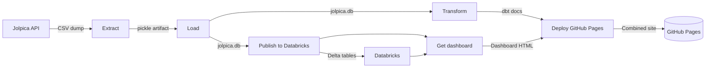
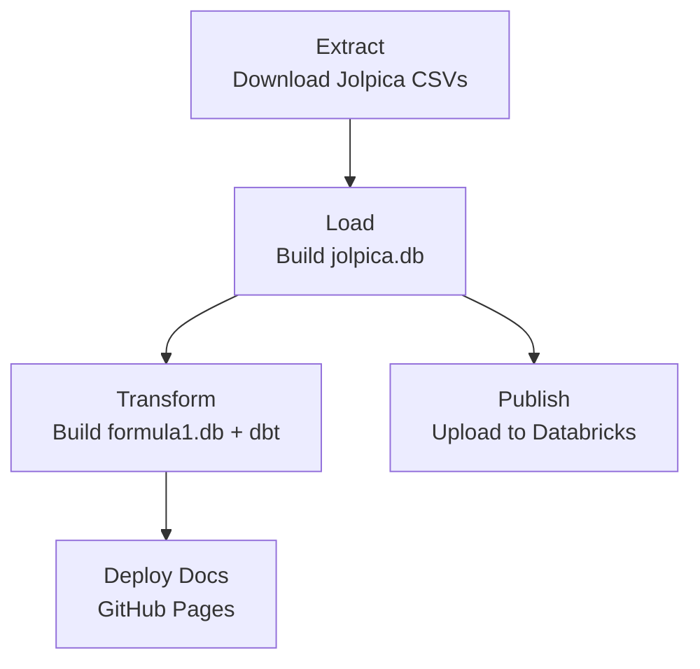
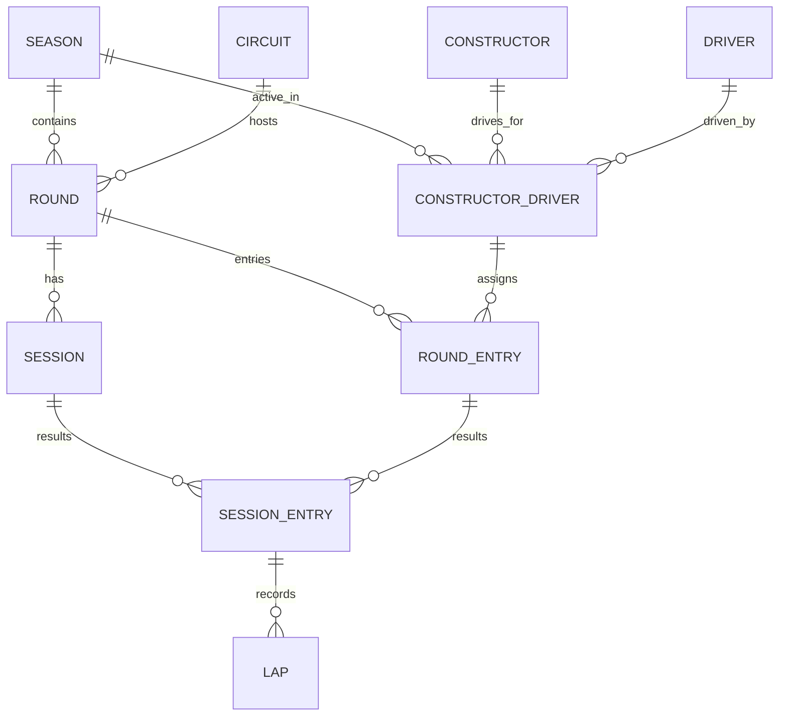

# F1 ELT Pipeline

[](https://github.com/jmr-lab/f1-elt-pipeline/actions)
[](LICENSE)
[](https://www.python.org/)
[](https://www.getdbt.com/)
[](https://www.databricks.com/)
[](https://jmr-lab.github.io/f1-elt-pipeline/)

An ELT pipeline that downloads the official F1 database dump from [Jolpica](https://api.jolpi.ca/) and transforms it into an analytics-ready dataset for Formula 1 analytics and driver GOAT analysis. Built with Python and [dbt](https://www.getdbt.com/) for modular, production-grade data transformations, with an optional publish step that mirrors the raw dataset into Databricks for interactive exploration.

## Overview

This ETL pipeline processes raw data from the Jolpica F1 database through four stages: **Extraction**, **Loading**, **Transformation**, and **Publishing**. The primary output is a normalised SQLite database with embedded analytic views designed for downstream consumption by the companion [Formula-1 Analytics](https://github.com/jmr-lab/Formula-1) R project. A secondary output mirrors the raw tables into Databricks for exploratory analysis.

> [!NOTE]
> This pipeline is actively developed. Planned enhancements include:
> 
> *   **Enhanced dbt transformations** — Additional derived metrics and staging layers.
> *   **Incremental models** — Optimised refresh strategy for large historical datasets.
> *   **Databricks-native transformations** — Moving the transform stage onto Databricks compute.

## Pipeline Architecture


### Pipeline Flow:

1. **Extract** — Downloads the full Jolpica database dump (19 CSV tables) with automatic freshness checks
2. **Load** — Builds the normalised SQLite star schema database (jolpica.db)
3. **Transform** — Produces formula1.db from transform-tables.sql, then runs dbt tests and generates documentation
4. **Publish** — Mirrors the raw tables into Databricks as Delta tables for interactive analysis

## Architectural Decisions & Trade-offs

Design decisions, their rationale, and deliberate omissions. Full records in [`docs/adr/`](docs/adr/).

| Decision | Rationale |
|----------|-----------|
| **SQLite as intermediate format** | Enables fast local validation of referential integrity before any cloud operation; keeps transform logic testable offline |
| **Full reload, not incremental** | ~890K rows; historical data only; retroactive steward rulings make append-only logic unsafe |
| **Parallel `transform` and `publish_databricks`** | A Databricks outage or token expiry must not block the SQLite build, release, or docs |
| **`main.`-qualified DROP statements** | Unqualified DROPs fall through to attached schemas and destroy source tables — see ADR-0006 |
| **Manual Databricks token rotation** | Free Edition tokens expire every 730 days and cannot be extended; automation would require a second long-lived credential |
| **Mutable `data-latest` release tag** | Simple for consumers; versioned immutable releases are a candidate improvement (see below) |

### Deliberately Not Implemented

**Incremental processing.** Full reloads are cheap at this scale and sidestep the problem of retroactive corrections — F1 stewards issue disqualifications and points adjustments after the fact, which append-only logic would miss. Revisit if runtime exceeds ~20 minutes or upstream introduces intra-day granularity.

**Schema drift detection.** Currently, an upstream column addition or rename would surface as a dbt test failure rather than a clear diagnostic. A per-table column hash checked at ingest would fail faster and with a better message.

**Immutable release versioning.** `data-latest` is overwritten each run, so downstream consumers cannot pin a specific dataset version. Publishing `data-YYYYMMDD` alongside the moving pointer would enable reproducible analysis.

### Known Constraints

- Databricks Free Edition: serverless-only compute, one 2X-Small SQL warehouse, 5 concurrent job tasks, fair-usage quota that suspends compute when exceeded
- Personal access tokens expire every 730 days max and cannot be extended after creation — only replaced
- `lap` (≈735K rows) is excluded from analysis; it dominates table size and is not needed for the current use case

## Workflow Execution

The workflow consists of three jobs that execute sequentially:



Each job runs on its own Ubuntu runner. Intermediate artefacts are passed between jobs using GitHub Actions artefact storage.

## Triggers

The workflow runs:

- **Weekly** automatically on a scheduled day to refresh the database
- **Manually** via the Run workflow button in the Actions tab

## Job Dependencies

| Job | Depends On | Produces |
| ----- | --- | ----------- |
| extract | None | output/extracted_data.pkl → extracted-data artefact |
| load | extract | dist/jolpica.db → jolpica-db artefact, committed to the repository |
| transform | load | dist/formula1.db → formula1-db artefact, dbt-docs artefact, data-latest release |
| publish_databricks | load | 19 Delta tables in the Databricks jolpica schema |
| deploy_docs | transform | dbt documentation site on GitHub Pages |

## Features

1. **Extract**
- Downloads the full F1 database dump from Jolpica (19 CSV tables)
- Automatic freshness check (skips download if data < 7 days old)
- Streaming download for large files (~40MB compressed)
- Preserves original Ergast/Jolpica table schemas

2. **Load**
- Normalises raw CSVs into a **star schema** SQLite database
- Foreign key validation ensures referential integrity
- 17+ tables including dimensions (driver, team, circuit, season) and facts (session_entry, lap, pit_stop)
- ~880K rows total covering all F1 races since 1950

3. **Transform**
- transform-tables.sql reshapes the raw schema into the analytics schema and defines the f1summary view
- **dbt** provides dependency tracking, column-level tests, and generated documentation over the transformed database
- Derived fields: driver age, cumulative points, country flag image paths
- Ready for expansion: add models, tests, and documentation via dbt

4. **Publish**
- Exports each raw SQLite table to Parquet, stages it in a Unity Catalog volume, and loads it into Delta tables via COPY INTO
- Automatic type widening: SQLite's loosely-typed columns are inspected and mapped to appropriate Spark types
- Row-count verification against the source before the run is considered successful

## Databricks Publishing

The publish_databricks job mirrors the raw dataset into Databricks, giving a queryable copy for exploratory analysis without needing to download the SQLite file.

| Property | Value |
| ----- | ----------- |
| Source | dist/jolpica.db |
| Target | Databricks schema jolpica |
| Tables | 17 |
| Staging | Unity Catalog volume f1_staging |
| Load mechanism | COPY INTO from Parquet |

Authentication uses a personal access token supplied through the DATABRICKS_TOKEN repository secret, along with DATABRICKS_SERVER_HOSTNAME, DATABRICKS_HTTP_PATH, and the DATABRICKS_CATALOG repository variable.

## Directory Structure

```
f1-etl-pipeline/
├── .github/workflows/
│   └── f1-etl-pipeline.yml        # CI/CD orchestration
├── dbt/
│   ├── dbt_project.yml            # dbt project configuration
│   ├── migrations/
│   │   └── transform-tables.sql   # Analytics schema + f1summary view
│   └── models/
│       └── sources.yml            # Source declarations, column docs & tests
├── dist/
│   ├── jolpica.db                 # Raw star schema DB (committed)
│   └── formula1.db                # Transformed DB with views (build artefact)
├── docs/
│   └── formula1_erd.mmd           # ERD source (Mermaid)
├── output/
│   └── extracted_data.pkl         # Intermediate pickle (workflow only)
├── scripts/
│   └── build_erd_page.py          # Wraps ERD into dbt docs site
├── src/
│   ├── 01-extract.py              # Download & unpack Jolpica CSVs
│   ├── 02-load.py                 # Build SQLite star schema DB
│   ├── 04-publish-databricks.py   # Publish raw tables to Databricks
│   └── resources/
│       └── countries_lookup.csv   # Country code → name mapping
└── README.md
```

## Outputs

| File | Location | Description |
| ----- | --- | ----------- |
| jolpica.db | dist/ | Normalised raw SQLite database (19 tables)
| formula1.db | dist/ | Transformed SQLite database with f1summary VIEW
| dbt docs | GitHub Pages | Generated documentation and lineage graph
| ERD | GitHub Pages | Entity-relationship diagram of the transformed schema

The database is distributed via:
1. **GitHub Releases** — Tagged as data-latest, downloadable from releases page
2. **Workflow Artefacts** — Available for 7 days after each run

## Database Schema

Core relationships in the transformed `formula1.db` — full diagram with all tables and columns: **[ERD](https://jmr-lab.github.io/f1-elt-pipeline/erd.html)**



### Dimension Tables:
| Table | Purpose |
| ----- | ----------- |
| season | Racing seasons (1950–present) |
| driver | Driver profiles |
| team | Constructor records |
| circuit | Track locations |
| base_team | Team inheritance (empty) |

### Fact Tables:
| Table | Purpose |
| ----- | ----------- |
| session_entry | Race results (primary fact) |
| lap | Per-lap timing data |
| pit_stop | Pit stop durations |
| driver_championship | Standings snapshots |
| team_championship | Constructor standings |

### Supporting Tables:
| Table | Purpose |
| ----- | ----------- |
| round | Race events |
| session | Practice/Qualifying/Race sessions |
| roundentry | Driver-team-Race assignments |
| team_driver | Driver-team contracts |

## The f1summary View

The f1summary view provides an analytics-ready flat table suitable for direct querying:
```sql
SELECT 
    driverName,
    COUNT(*) as races,
    SUM(points) as career_points
FROM f1summary
WHERE positionOrder = 1
GROUP BY driverName
ORDER BY races DESC;
```

### Sample output columns:

| Column                 | Type            | Description                                |
| ---------------------- | --------------- | ------------------------------------------ |
| `resultId`             | INT             | Unique result identifier                   |
| `grid`                 | INT             | Starting grid position                     |
| `positionOrder`        | INT             | Finishing position order                   |
| `laps`                 | INT             | Number of laps completed in the race       |
| `rank`                 | INT             | Overall ranking classification             |
| `status`               | VARCHAR(100)    | Race finish status                         |
| `points`               | DOUBLE          | Points awarded for the race                |
| `cumulPoints`          | DOUBLE          | Cumulative driver points at race           |
| `year`                 | INT             | Season year                                |
| `round`                | INT             | Round number within season                 |
| `circuit`              | VARCHAR(255)    | Circuit name                               |
| `driverName`           | VARCHAR(255)    | Full driver name                           |
| `driverCountry`        | VARCHAR(100)    | Driver's country of origin                 |
| `driverAge`            | INT             | Driver age in years at race date           |
| `constructorName`      | VARCHAR(255)    | Team name                                  |
| `constructorCountry`   | VARCHAR(100)    | Constructor's country of origin            |
| `driverImage`          | VARCHAR(255)    | Path to flag icon                          |
| `constructorImage`     | VARCHAR(255)    | Path to flag icon                          |

### Sample Data

Below is an extract from the output dataset showing a subset of rows and columns (not all data displayed for readability). This excerpt covers the opening races from the 1950 British Grand Prix (the first Formula 1 World Championship race):

| year | round | circuit | status | laps | driverName | constructorName | positionOrder | points |
| ---- | ----- | ------- | ------ | ---- | ---------- | --------------- | ------------- | ------ |
| 1950 | 1 | British Grand Prix | Finished | 70 |  Nino Farina |  Alfa Romeo | 1 | 9 |
| 1950 | 1 | British Grand Prix | Finished | 70 |  Luigi Fagioli |  Alfa Romeo | 2 | 6 |
| 1950 | 1 | British Grand Prix | Finished | 70 |  Reg Parnell |  Alfa Romeo | 3 | 4 |
| 1950 | 1 | British Grand Prix | Lapsed | 68 |  Yves Cabantous |  Talbot-Lago | 4 | 3 |
| 1950 | 1 | British Grand Prix | Lapsed | 68 |  Louis Rosier |  Talbot-Lago | 5 | 2 |
| 1950 | 1 | British Grand Prix | Lapsed | 67 |  Bob Gerard |  ERA | 6 | 0 |

*Full dataset contains 27,238 rows spanning from 1950 to the current year minus one.*

## Installation

Clone this repository and install dependencies:
```bash
git clone https://github.com/jmr-lab/f1-etl-pipeline.git
cd f1-etl-pipeline

# Install Python dependencies
pip install pandas requests

# Install dbt dependencies (for transformation step)
pip install "dbt-core>=1.8,<2.0" "dbt-sqlite>=1.8,<2.0"

# Install Databricks dependencies (for the publish step)
pip install "databricks-sql-connector>=3.0" pyarrow
```

## Usage

### Running the Pipeline Locally

```bash
# Step 1: Extract (download Jolpica data)
python src/01-extract.py

# Step 2: Load (build SQLite database)
python src/02-load.py

# Step 3: Transform (build formula1.db, then run dbt)
cd dist && sqlite3 formula1.db < ../dbt/migrations/transform-tables.sql && cd ..
cd dbt && dbt run && cd ..

# Step 4: Publish to Databricks (requires credentials)
export DATABRICKS_SERVER_HOSTNAME=...
export DATABRICKS_HTTP_PATH=...
export DATABRICKS_TOKEN=...
export DATABRICKS_CATALOG=...
python src/04-publish-databricks.py
```

### Querying the Database

Download the latest database from GitHub Releases, then query locally:

```bash
# List all tables
sqlite3 dist/formula1.db ".tables"

# Query the f1summary view
sqlite3 dist/formula1.db "SELECT COUNT(*) FROM f1summary WHERE position = 1 AND driverName LIKE '%Hamilton%';"

# Count races per driver
sqlite3 dist/formula1.db "SELECT driverName, COUNT(*) as races FROM f1summary GROUP BY driverName ORDER BY races DESC LIMIT 10;"
```

## Data Source

All raw data originates from Jolpica, a maintained fork of the Ergast F1 Database API. Jolpica provides complete historical coverage from the first F1 World Championship race (1950 British Grand Prix) through the most recent completed season.

## Technologies

- **Python 3.11+** : ETL orchestration and data processing
- **pandas** : CSV parsing and DataFrame manipulation
- **SQLite** : Lightweight relational database (single-file)
- **dbt 1.9.x** : SQL transformations and view management
- **Databricks** : Cloud lakehouse for interactive analysis of the raw dataset
- **GitHub Actions** : Automated CI/CD pipeline
- **GitHub Pages** : Hosted dbt documentation

## Related Projects

| Project               | Language         | Purpose                              |
| --------------------- | ---------------- | ------------------------------------ |
| Formula-1 Analytics   | R (tidyverse)    | EDA, visualisations, GOAT modelling  |

## Data Freshness

By default, the pipeline skips downloading if the most recent CSV file is less than 7 days old. To force a refresh:

- Delete all files in output/ and run again, or
- Modify days_threshold in src/01-extract.py to a lower value

## Troubleshooting

### Download Failed

If the Jolpica database download fails:

- Check your internet connection
- Verify the endpoint is accessible:
```bash
   curl -I https://api.jolpi.ca/data/dumps/download/delayed/?dump_type=csv
```
- Retry the workflow manually from the Actions tab

### dbt Profile Error

If you encounter schemas_and_paths or profile configuration errors:

- Ensure dbt-sqlite==1.9.1 is installed (compatible with dbt-core 1.9.x)
- Verify ~/.dbt/profiles.yml was created by the workflow step
- Check dbt_project.yml references profile: 'sqlite'

### Databricks Authentication Failed

If the publish job fails with an authentication or token error:

- Databricks personal access tokens expire and cannot be extended after creation
- Generate a new token in Settings → Developer → Access Tokens
- Update the DATABRICKS_TOKEN repository secret with the new value
- Re-run the workflow manually

### No Changes to Commit

If the database hasn't changed since the last run:

- The pipeline will detect this and skip committing
- This is normal behaviour when Jolpica's data hasn't updated
